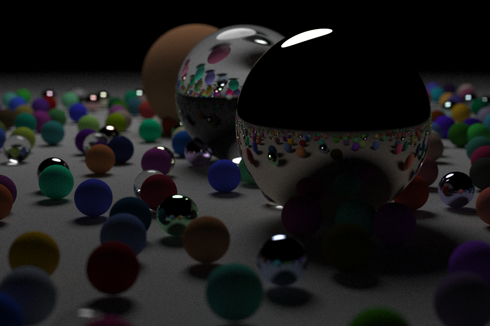
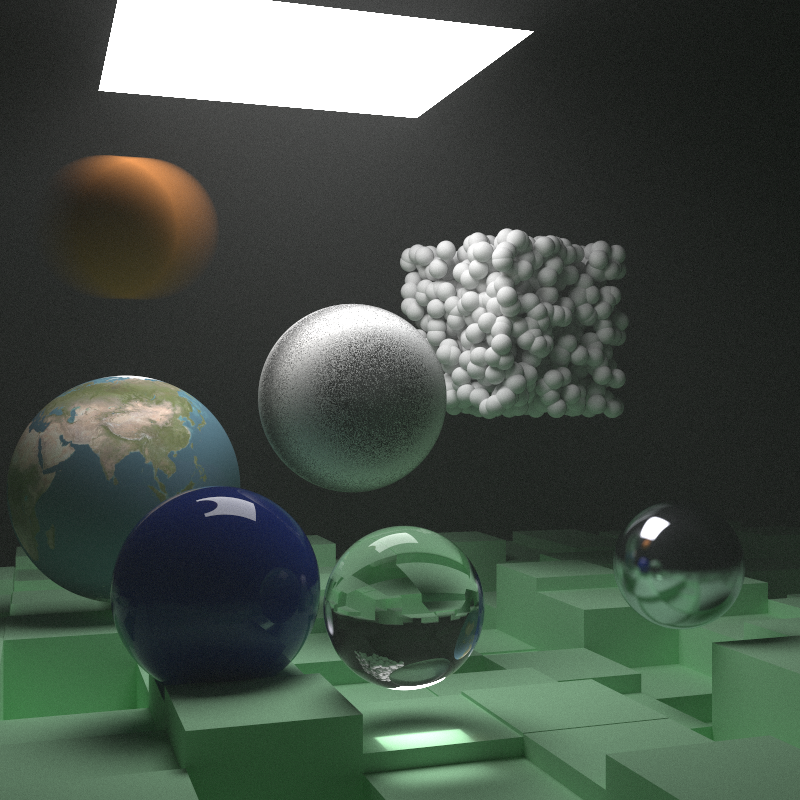

# raytracing-weekend

Simple path renderer written in modern C. Based on [_Ray Tracing in One
Weekend_](https://raytracing.github.io/books/RayTracingInOneWeekend.html) and [_Ray Tracing: The Next Week_](https://raytracing.github.io/books/RayTracingTheNextWeek.html) books by Peter Shirley.

This project uses [PPM image format](https://en.wikipedia.org/wiki/Netpbm#PPM_example) to simplify image output routines. This is far from optimal but should work.

Here's the sample scene from the cover of the first book:



And a showcase from the second: 



Apart from the core ray tracer I've decided to add parallel rendering -- right now it has implementation for UNIX-like systems and Windows. Also there are command line options that are available by calling a ray tracer with `-h` or `--help` flags.

I've selected C because I wanted some challenge and I think I got some. I decided to make vector and ray routines completely inlined to remove some overhead from function calls. I could have gone with macros but I thought the inlines will suit better. Because of that even in debug mode code compiles with inline optimizations enabled.

Also I had to implement something like polymorphism and encapsulation and I think my implementation is pretty efficient and not completely ugly in terms of code. I also implemented my own simplified version of `shared_ptr` based on reference counting for all the renderer units. Seem to work fine.

I'm not sure if my render is entirely correct but I'm pretty happy with it considering it's my first raytracer. I know it's slow and not really optimized and accurate but the images look really nice to me.

## Building

This project uses CMake to generate build system files. It's using presets to simplify the configuration.

1. Run CMake to configure the project. I recommend [Ninja](https://ninja-build.org/) as a build system, but UNIX Makefiles
   will work too.
   ```bash
   ? cmake --preset release
   ```
   or
    ```bash
   ? cmake --preset release -G "Unix Makefiles"
   ```
   to configure the Makefile-based build system.
1. Build the application
   ```bash
   ? cmake --build --preset release
   ```
1. Launch the application and view image
   ```bash
   ? ./cmake-build-release/bin/ray_tracing_one_week image.ppm
   # The following line should open file in image viewer right from the console although it may not work -- depends on the distro settings
   ? xgd-open image.ppm
   ```
   On macOS:
   ```bash
   ? open image.ppm
   ```
   To view supported flags and options:
   ```
   ? ./cmake-build-release/bin/ray_tracing_one_wee --h
   ```
